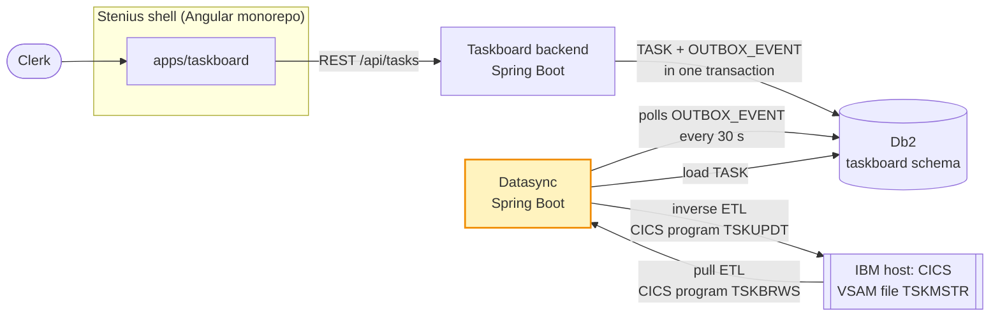
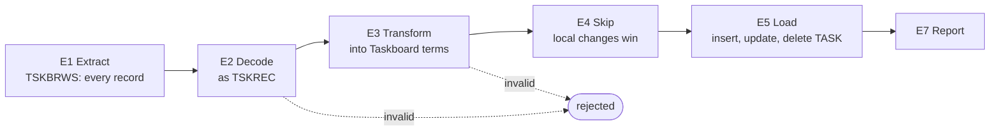
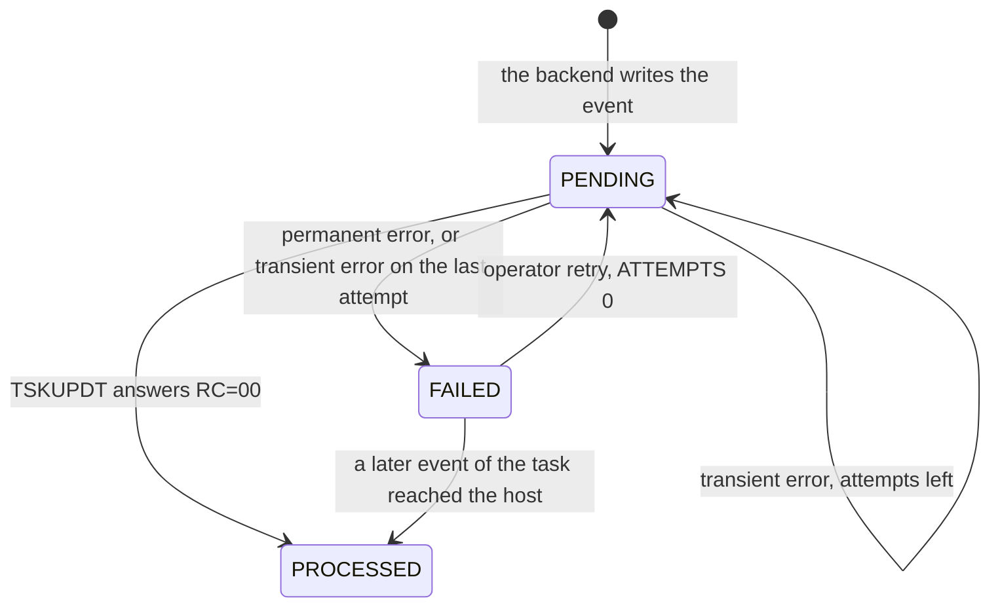

# Taskboard datasync (CICS)

The datasync keeps the IBM host and the new Taskboard eventually consistent. A pull ETL loads the
task records of the host's VSAM file TSKMSTR into the Taskboard's Db2 database, and an outbox relay
writes every change made in the Taskboard back to the host through the CICS program TSKUPDT. The
repository also contains a small CICS host simulator, so the whole system runs on a laptop.



## What it does

- **Pull ETL, host to Db2.** At start-up and then every 60 s, it reads every record of TSKMSTR
  through TSKBRWS and inserts, updates or deletes the matching TASK rows. Local changes that have
  not reached the host yet are left alone, and nothing it loads is echoed back to the host.
- **Outbox relay, Db2 to host.** At start-up and then every 30 s, it writes the backend's PENDING
  OUTBOX_EVENT rows to the host with TSKUPDT, in order per task, retrying transient errors. A
  change that cannot be delivered becomes a *host inconsistency* that an operator can retry.
- **Sync API on port 8081.** Status, runs on request, the host inconsistencies and their retry.
- **CICS host simulator on port 8090.** TSKBRWS and TSKUPDT over HTTP on an in-memory TSKMSTR,
  plus an admin API to look into the file, simulate an outage and reset it. For local runs and
  demos only; the datasync's tests never need it.
- **One record layout.** [`copybooks/TSKREC.cpy`](copybooks/TSKREC.cpy) is the source of truth
  that both modules implement; a test in each module checks its field layout against it.

## Quickstart

You need Java 21 (a JDK), and curl for the examples. Maven comes with the wrapper; the first build
downloads it.

```sh
./mvnw verify                                   # build both modules, run all tests, check the formatting
./mvnw -pl cics-host-simulator spring-boot:run  # the CICS host simulator, http://localhost:8090
./mvnw -pl datasync spring-boot:run             # the datasync, http://localhost:8081
```

Both apps are ready when their `/actuator/health` answers UP. The datasync works on the shared
Taskboard database, which the backend serves on `localhost:9092`, so start the backend first (see
[Run the whole Taskboard system locally](#run-the-whole-taskboard-system-locally)).

### Run it without the backend

To work on the datasync alone, stand in for the shared database with an H2 server, create the
schema from the test copy, and point the datasync at it. The H2 jar is in your Maven repository
after `./mvnw verify` (2.4.240 is the version Spring Boot 4.1.1 manages). From the repository root,
with the server and the datasync each in its own terminal:

```sh
java -cp ~/.m2/repository/com/h2database/h2/2.4.240/h2-2.4.240.jar org.h2.tools.Server -tcp -tcpPort 19092 -ifNotExists
java -cp ~/.m2/repository/com/h2database/h2/2.4.240/h2-2.4.240.jar org.h2.tools.RunScript -url 'jdbc:h2:tcp://localhost:19092/mem:taskboard;MODE=DB2;DB_CLOSE_DELAY=-1' -user sa -script datasync/src/test/resources/db/taskboard-schema.sql
SPRING_DATASOURCE_URL='jdbc:h2:tcp://localhost:19092/mem:taskboard;MODE=DB2' ./mvnw -pl datasync spring-boot:run
```

`DB_CLOSE_DELAY=-1` keeps the in-memory database alive for as long as the H2 server runs. Without
the backend, change tasks with SQL the way the backend does: the TASK row together with a PENDING
outbox event that carries the task's snapshot. For example, open H2's shell on the database:

```sh
java -cp ~/.m2/repository/com/h2database/h2/2.4.240/h2-2.4.240.jar org.h2.tools.Shell -url 'jdbc:h2:tcp://localhost:19092/mem:taskboard;MODE=DB2' -user sa
```

and create a task, which the next relay run writes to the host under `T` plus its ID:

```sql
INSERT INTO TASK (TITLE, STATUS, SOURCE, CREATED_AT, UPDATED_AT)
VALUES ('Call back about the invoice', 'OPEN', 'TASKBOARD', TIMESTAMP '2026-10-14 08:15:30', TIMESTAMP '2026-10-14 08:15:30');
INSERT INTO OUTBOX_EVENT (AGGREGATE_TYPE, AGGREGATE_ID, EVENT_TYPE, PAYLOAD, CREATED_AT)
SELECT 'TASK', ID, 'TASK_CREATED', '{"taskId":' || ID || ',"hostId":null,"title":"Call back about the invoice","description":null,"status":"OPEN","assignee":null,"dueDate":null,"source":"TASKBOARD","occurredAt":"2026-10-14T08:15:30Z"}', UPDATED_AT
FROM TASK WHERE ID = (SELECT MAX(ID) FROM TASK);
```

## Configuration

Every setting comes from `application.properties` and can be overridden with an environment
variable (Spring Boot's relaxed binding: upper case, dots to underscores, dashes dropped).

| Property | Environment variable | Default | Meaning |
|---|---|---|---|
| `spring.datasource.url` | `SPRING_DATASOURCE_URL` | `jdbc:h2:tcp://localhost:9092/mem:taskboard;MODE=DB2` | The shared Taskboard database. Locally the backend's H2 (DB2 mode); in production the Db2 database the backend uses |
| `spring.datasource.username` | `SPRING_DATASOURCE_USERNAME` | `sa` | Database user |
| `spring.datasource.password` | `SPRING_DATASOURCE_PASSWORD` | empty | Database password |
| `datasync.host.base-url` | `DATASYNC_HOST_BASEURL` | `http://localhost:8090` | Where the CICS programs are called: `<base-url>/cics/TSKBRWS`, `<base-url>/cics/TSKUPDT` |
| `datasync.host.connect-timeout` | `DATASYNC_HOST_CONNECTTIMEOUT` | `2s` | How long connecting to the host may take |
| `datasync.host.read-timeout` | `DATASYNC_HOST_READTIMEOUT` | `10s` | How long a CICS program may take to answer |
| `datasync.etl.interval` | `DATASYNC_ETL_INTERVAL` | `60s` | Delay between two ETL runs; the first runs at start-up |
| `datasync.outbox.interval` | `DATASYNC_OUTBOX_INTERVAL` | `30s` | Delay between two relay runs; the first runs at start-up |
| `datasync.outbox.batch-size` | `DATASYNC_OUTBOX_BATCHSIZE` | `100` | PENDING events one relay run reads at most |
| `datasync.outbox.max-attempts` | `DATASYNC_OUTBOX_MAXATTEMPTS` | `5` | Attempts after which an event with transient errors becomes FAILED |
| `datasync.scheduling.enabled` | `DATASYNC_SCHEDULING_ENABLED` | `true` | `false` turns both schedules off; the ETL and the relay then run only on request |
| `server.port` | `SERVER_PORT` | `8081` | Port of the sync API and `/actuator/health` |

The simulator has two settings: `server.port` (`SERVER_PORT`, default `8090`) and `simulator.seed`
(`SIMULATOR_SEED`, default `classpath:tskmstr-seed.dat`), the fixed-width file TSKMSTR is loaded
from at start and on reset.

## How the datasync works

### The host record: copybook TSKREC

TSKMSTR is a VSAM KSDS keyed by TSK-ID. Each record is a TSK-RECORD of 300 characters, laid out by
[`copybooks/TSKREC.cpy`](copybooks/TSKREC.cpy):

```cobol
      * TSKREC - task master record, VSAM KSDS TSKMSTR, key TSK-ID
       01  TSK-RECORD.
           05  TSK-ID              PIC X(10).
           05  TSK-TITLE           PIC X(40).
           05  TSK-DESC            PIC X(200).
           05  TSK-STATUS          PIC X(01).
               88  TSK-OPEN                VALUE 'O'.
               88  TSK-IN-PROGRESS         VALUE 'I'.
               88  TSK-DONE                VALUE 'D'.
               88  TSK-DELETED             VALUE 'X'.
           05  TSK-USER            PIC X(08).
           05  TSK-DUE-DATE        PIC 9(08).
           05  TSK-ORIGIN          PIC X(01).
               88  TSK-FROM-HOST           VALUE 'H'.
               88  TSK-FROM-TASKBOARD      VALUE 'T'.
           05  TSK-LAST-UPD        PIC X(26).
           05  FILLER              PIC X(06).
```

| Field | Offset | Length | Content |
|---|---|---|---|
| TSK-ID | 0 | 10 | The key. Tasks from the host have keys like `H000001001`; a task from the Taskboard gets `T` plus its TASK.ID in 9 digits (task 42 is `T000000042`) |
| TSK-TITLE | 10 | 40 | Text, left-aligned and padded with spaces |
| TSK-DESC | 50 | 200 | Text, left-aligned and padded with spaces |
| TSK-STATUS | 250 | 1 | `O` open, `I` in progress, `D` done, `X` deleted: the host keeps deleted records |
| TSK-USER | 251 | 8 | The assignee's user id in upper case, blank for none |
| TSK-DUE-DATE | 259 | 8 | `YYYYMMDD`, `00000000` for none |
| TSK-ORIGIN | 267 | 1 | `H` created on the host, `T` created in the Taskboard |
| TSK-LAST-UPD | 268 | 26 | Host timestamp `YYYY-MM-DD-HH.MM.SS.NNNNNN` in UTC |
| FILLER | 294 | 6 | Spaces |

The CICS programs are called over HTTP, the way CICS web services or a CICS Transaction Gateway
expose them: `POST /cics/<program>` with the COMMAREA as plain text. The real host speaks EBCDIC;
this model stays readable ASCII, one record per line, so that records can be read in logs, tests and
the simulator's admin view. `TskRecordCodec` reads and writes the fixed-width form, the simulator
has its own reader, and both have a test that compares their layout with the copybook.

### Pull ETL: host to Db2

A full sync of the TASK table from the host, at start-up and then with a fixed delay of
`datasync.etl.interval` (60 s). `EtlJob` runs these steps:



| Step | Rule |
|---|---|
| E1 Extract | TSKBRWS returns every record of TSKMSTR. The file is small, so every run is a full sync |
| E2 Decode | Every line is decoded as TSKREC. A record of the wrong length, without key, with an unknown status or origin, or with an invalid due date or timestamp is rejected: logged at WARN with its key and the reason, and not loaded |
| E3 Transform | Texts are trimmed and blank ones become null; the host values become the Taskboard's (mapping table below). A record the Taskboard cannot hold is rejected too: one without title, or with a user that is not a valid Taskboard user id (`^[a-z][a-z0-9]{0,7}$` once lower-cased) |
| E4 Skip | Local changes win until they have reached the host: a record is skipped when its task's latest outbox event (highest ID) is PENDING or FAILED. Task id and host key come from those events' payloads, because a task deleted in the Taskboard has no TASK row left to look them up in. That keeps a pending delete from bringing the task back. The ETL reads these events before E1, so a change the relay delivers during the extract is skipped as well, not overwritten with the older record |
| E5 Load | A record matches the task with its key as HOST_ID; a T key also matches the task with the TASK.ID in the key that has no HOST_ID yet (which then gets it). A match is updated when anything differs, otherwise it is unchanged. Status X deletes the matched task. Without a match, a record from the host (origin H) is inserted with source HOST, its HOST_ID, and CREATED_AT and UPDATED_AT from TSK-LAST-UPD; a record from the Taskboard (origin T) never creates a task, it is orphaned |
| E6 | The ETL writes TASK only, never OUTBOX_EVENT, so its loads are never echoed back to the host |
| E7 Report | Every run reports what it did with the records it read |

Every record read lands in exactly one of the other counts, so `read` is their sum:

| Count | Meaning |
|---|---|
| `read` | Records TSKBRWS returned |
| `inserted` | New tasks from the host |
| `updated` | Tasks that differed from their record |
| `unchanged` | Tasks that already matched their record, and deleted records without a task (nothing to delete) |
| `deleted` | Tasks deleted because their record has status X |
| `skipped` | Records of tasks with a change that has not reached the host yet (E4) |
| `orphaned` | Records from the Taskboard without a task |
| `rejected` | Invalid records, and records the Taskboard cannot hold |

The first run against the simulator's seed reads 8 records, inserts 7 tasks and counts the deleted
record as unchanged. If the host is unavailable, the run fails as a whole and loads nothing; the
next run catches up, because every run is a full sync.

### Field mapping in both directions

| Host field | TASK column | Host to Taskboard (ETL, E3) | Taskboard to host (relay, R3) |
|---|---|---|---|
| TSK-ID | HOST_ID | The key becomes HOST_ID. A T key also finds a task by the TASK.ID in it | The payload's `hostId`, or `T` plus `taskId` in 9 digits |
| TSK-TITLE | TITLE | Trimmed | Padded with spaces to 40 |
| TSK-DESC | DESCRIPTION | Trimmed, blank becomes null | Null becomes blanks; padded with spaces to 200 |
| TSK-STATUS | STATUS | `O`, `I`, `D` become `OPEN`, `IN_PROGRESS`, `DONE`; `X` deletes the task | `OPEN`, `IN_PROGRESS`, `DONE` become `O`, `I`, `D`; a TASK_DELETED event writes `X` |
| TSK-USER | ASSIGNEE | Lower-cased, blank becomes null | Upper-cased, null becomes blanks |
| TSK-DUE-DATE | DUE_DATE | `YYYYMMDD` becomes a date, `00000000` null | A date becomes `YYYYMMDD`, null `00000000` |
| TSK-ORIGIN | SOURCE | `H` becomes `HOST`, `T` becomes `TASKBOARD` | `HOST` becomes `H`, `TASKBOARD` becomes `T` |
| TSK-LAST-UPD | UPDATED_AT, and CREATED_AT on insert | The host timestamp, as a UTC timestamp | The payload's `occurredAt`, to the microsecond |

A host record is one line, so the relay turns control characters such as line breaks into spaces.
A value too long for its field is never cut: the event fails (see below).

### Outbox relay: Db2 to host

The backend writes every change of a task and an OUTBOX_EVENT row in one transaction: STATUS
PENDING, ATTEMPTS 0, and as PAYLOAD a JSON snapshot of the whole task after the change (for
TASK_DELETED, its last state). `OutboxRelay` writes these changes to the host, at start-up and then
with a fixed delay of `datasync.outbox.interval` (30 s). The scheduler has two threads, so the ETL
and the relay never delay each other.



| Step | Rule |
|---|---|
| R1 Load | Up to `datasync.outbox.batch-size` (100) PENDING events, ordered by ID |
| R2 Order | Each task's changes reach the host in their order: once an event of a task stays PENDING after a failed attempt, the task's later events wait for the next run. FAILED events do not hold anything up, because every payload is a full snapshot |
| R3 Inverse transformation | The payload becomes a TSK-RECORD (mapping table above) |
| R4 Write | TSKUPDT writes the record. On RC=00 the event becomes PROCESSED with PROCESSED_AT, ATTEMPTS + 1 and no LAST_ERROR, and the task gets its host key as HOST_ID if it has none yet |
| R5 Retry | Transient errors add an attempt and record LAST_ERROR; the event stays PENDING until ATTEMPTS reaches `datasync.outbox.max-attempts` (5), then it is FAILED. Permanent errors make it FAILED at once |
| R6 Host inconsistency | A FAILED event is logged at ERROR with event id, task id and reason, listed by the API and counted in the status |
| R7 Transactions | Each event's status update is its own transaction, never held open during the call to the host. TSKUPDT is idempotent, so a crash re-sends at most one event |

| Error | Kind | Example LAST_ERROR |
|---|---|---|
| Host unreachable, or no connection within the connect timeout | transient | `TSKUPDT failed: cannot connect to http://localhost:8090` |
| No answer within the read timeout | transient | `TSKUPDT failed: no answer within 10000 ms` |
| HTTP 5xx, for example while the CICS region is down | transient | `TSKUPDT answered HTTP 503: CICS region unavailable` |
| Any answer other than RC=00 or RC=12 | transient | `TSKUPDT answered 'RC=04 ...' instead of RC=00` |
| Unparseable payload | permanent | `unparseable payload: no title` |
| A value too long for its field | permanent | `TSK-TITLE has 41 characters, at most 40 fit` |
| Unknown event type | permanent | `unknown event type TASK_ARCHIVED` |
| TSKUPDT rejects the record (RC=12) | permanent | `TSKUPDT rejected the record: RC=12 TSK-STATUS 'Q' is not O, I, D or X` |

**Host inconsistencies.** A FAILED event is a change in the Taskboard that the host does not have;
the Taskboard shows its task as "Host inconsistency". To resolve one, fix the cause (end the outage,
correct the data), then retry the event: `POST /api/sync/inconsistencies/{eventId}/retry` sets it
back to PENDING with ATTEMPTS 0, and the next relay run writes it. When a later event of the same
task reaches the host, its full snapshot carries the failed change too: the relay then marks the
task's older FAILED events PROCESSED with LAST_ERROR `superseded by event <id>`, so that nobody
retries an old snapshot over newer data.

**What production would add.** In production the datasync and the backend use the same Db2
database: `SPRING_DATASOURCE_URL`, `SPRING_DATASOURCE_USERNAME` and `SPRING_DATASOURCE_PASSWORD`
point at it, and IBM's Db2 JDBC driver takes the place of H2. The model assumes a single datasync
instance. Several instances would need a scheduler lock such as ShedLock, or would claim events
with `SELECT ... FOR UPDATE SKIP LOCKED`. A real gateway converts between EBCDIC and the database's
code page, where field lengths count bytes, not characters. A change made in the Taskboard while an
ETL run is loading can be overwritten in TASK until the relay has written it and the next run
loads it again; locking the task's row and re-checking the skip rule in the same transaction as
each write would close that window. Host inconsistencies would raise an alert, not only a log
line and a count.

### Sync API

| Method and path | Response |
|---|---|
| `GET /api/sync/status` | The last ETL run with its report, the outbox events by status, the number of host inconsistencies |
| `POST /api/sync/etl/run` | Runs the ETL now and returns the run with its report; 503 (problem+json) while the host is unavailable |
| `POST /api/sync/outbox/run` | Runs the relay now and returns the run with its report |
| `GET /api/sync/inconsistencies` | The FAILED events, oldest first |
| `POST /api/sync/inconsistencies/{eventId}/retry` | Sets the FAILED event back to PENDING with ATTEMPTS 0 and returns it; 404 (problem+json) if no FAILED event has this id |
| `GET /actuator/health` | The app and its database only (components such as `db`, `diskSpace` and `ping`): DOWN without the database, but UP while the host is down. Host problems show in the status |

A run on request waits for a scheduled run of the same job in progress, so two runs of a job never
overlap. The status during an outage:

```json
{
  "etl": {
    "lastRun": {
      "startedAt": "2026-10-14T14:47:29.803Z",
      "finishedAt": "2026-10-14T14:47:29.809Z",
      "outcome": "FAILED",
      "error": "TSKBRWS answered HTTP 503: CICS region unavailable",
      "report": null
    }
  },
  "outbox": {
    "pending": 0,
    "processed": 3,
    "failed": 1,
    "lastRun": {
      "startedAt": "2026-10-14T14:48:59.832Z",
      "finishedAt": "2026-10-14T14:48:59.841Z",
      "outcome": "SUCCEEDED",
      "error": null,
      "report": { "read": 1, "processed": 0, "deferred": 0, "failed": 1, "skipped": 0 }
    }
  },
  "hostInconsistencies": 1
}
```

In the relay's report, every event read lands in exactly one of the other counts: `processed`
(written to the host), `deferred` (a transient error, it stays PENDING), `failed` (now FAILED) or
`skipped` (an earlier event of its task was deferred in this run).

### The CICS host simulator

`cics-host-simulator` stands in for the CICS region in local runs and demos. TSKMSTR lives in
memory, keyed and sorted by TSK-ID like a KSDS, and is loaded at start from the fixed-width seed
[`tskmstr-seed.dat`](cics-host-simulator/src/main/resources/tskmstr-seed.dat): eight back-office
tasks from `H000001001` to `H000001008` with mixed statuses, some assigned, some with due dates,
and one deleted with status X.

| Method and path | What it does |
|---|---|
| `POST /cics/TSKBRWS` | Browses TSKMSTR: `text/plain`, every record as one 300-character line, in key order |
| `POST /cics/TSKUPDT` | Takes one TSK-RECORD as `text/plain` and inserts it or replaces the record with its TSK-ID. Answers 200 `RC=00`, or 422 `RC=12 <reason>` for an invalid record. A trailing line break is ignored |
| `GET /admin/tskmstr` | The records as JSON, each field under its copybook name |
| `GET /admin/tskmstr/raw` | The records as stored, fixed width |
| `GET /admin/outage`, `POST /admin/outage` | Shows or sets the simulated outage: `{"down": true}` or `{"down": false}`. While it is down, everything under `/cics/` answers 503 `CICS region unavailable` |
| `POST /admin/reset` | Reloads the seed and drops every change since the start (204) |
| `GET /actuator/health` | The simulator itself, also during a simulated outage |

### Demo script

With the whole system running (see the next section), in a second terminal:

```sh
# The host's records, and an ETL run on request (the first one ran at start-up)
curl -s http://localhost:8090/admin/tskmstr
curl -s -X POST http://localhost:8081/api/sync/etl/run

# A clerk on the host closes H000001003: TSKUPDT writes its record with status D
curl -s http://localhost:8090/admin/tskmstr/raw | grep '^H000001003' | sed 's/^\(.\{250\}\)./\1D/' | curl -s -X POST http://localhost:8090/cics/TSKUPDT -H 'Content-Type: text/plain' --data-binary @-
curl -s -X POST http://localhost:8081/api/sync/etl/run      # "updated": 1, the task is DONE in the Taskboard
```

Change a task in the Taskboard, then relay it at once instead of waiting up to 30 s:

```sh
curl -s -X POST http://localhost:8081/api/sync/outbox/run   # "processed": 1
curl -s http://localhost:8090/admin/tskmstr                 # the host has the change
```

Take the host down, change a task in the Taskboard again, and run the relay five times:

```sh
curl -s -X POST http://localhost:8090/admin/outage -H 'Content-Type: application/json' -d '{"down":true}'
for i in 1 2 3 4 5; do curl -s -X POST http://localhost:8081/api/sync/outbox/run; echo; done
curl -s http://localhost:8081/api/sync/inconsistencies      # the FAILED event, with its eventId
curl -s http://localhost:8081/api/sync/status               # "hostInconsistencies": 1
curl -s http://localhost:8081/actuator/health               # still UP
```

The first four attempts defer the event and the fifth fails it (a scheduled run in between counts
as an attempt too). End the outage and retry the event:

```sh
curl -s -X POST http://localhost:8090/admin/outage -H 'Content-Type: application/json' -d '{"down":false}'
curl -s -X POST http://localhost:8081/api/sync/inconsistencies/<eventId>/retry
curl -s -X POST http://localhost:8081/api/sync/outbox/run   # "processed": 1, the task is in sync again
curl -s -X POST http://localhost:8090/admin/reset           # back to the seed for the next demo
```

## Run the whole Taskboard system locally

You need Java 21, Node 22 or later and the three repositories cloned side by side: [harness_demo_taskboard_backend](https://github.com/Fzum/harness_demo_taskboard_backend), [harness_demo_taskboard_datasync_cics](https://github.com/Fzum/harness_demo_taskboard_datasync_cics) and [harness_demo_taskboard_frontend_stenius](https://github.com/Fzum/harness_demo_taskboard_frontend_stenius). Start them in this order, each in its own terminal:

| # | Process | Repository | Command | Ready when |
|---|---|---|---|---|
| 1 | Backend and the shared database | harness_demo_taskboard_backend | `./mvnw spring-boot:run` | http://localhost:8080/actuator/health is UP |
| 2 | CICS host simulator | harness_demo_taskboard_datasync_cics | `./mvnw -pl cics-host-simulator spring-boot:run` | http://localhost:8090/actuator/health is UP |
| 3 | Datasync | harness_demo_taskboard_datasync_cics | `./mvnw -pl datasync spring-boot:run` | http://localhost:8081/actuator/health is UP |
| 4 | Taskboard UI | harness_demo_taskboard_frontend_stenius | `npm ci && npm start` | http://localhost:4200 loads |

Try it:

1. Open http://localhost:4200. The host's tasks appear after the datasync's first ETL run (at start-up, then every 60 s; `curl -X POST http://localhost:8081/api/sync/etl/run` runs it at once).
2. Create a task. It shows "Pending host sync" until the outbox relay has written it to the host, at most 30 s later, then "In sync with host". `curl http://localhost:8090/admin/tskmstr` shows the host's records.
3. Simulate a host outage with `curl -X POST http://localhost:8090/admin/outage -H 'Content-Type: application/json' -d '{"down":true}'` and change a task: after five failed relay attempts (about 2.5 minutes) it shows "Host inconsistency", and `curl http://localhost:8081/api/sync/inconsistencies` lists the event. End the outage with `-d '{"down":false}'` and retry it with `curl -X POST http://localhost:8081/api/sync/inconsistencies/<eventId>/retry`.

## Project structure

```text
.
├── copybooks/TSKREC.cpy           host record layout, the source of truth of both modules
├── datasync/                      the datasync: Spring Boot, port 8081, com.example.datasync
│   └── src/
│       ├── main/java/com/example/datasync/
│       │   ├── host/              TSKREC record and codec, host keys, client for the CICS programs
│       │   ├── etl/               pull ETL, host to Db2 (E1 to E7)
│       │   ├── outbox/            outbox relay, Db2 to host (R1 to R7), host inconsistencies
│       │   ├── task/              the TASK table
│       │   ├── api/               the sync API
│       │   └── *.java             application, settings, scheduling, run bookkeeping
│       └── test/                  tests, HostStub, verbatim schema copy in resources/db/
├── cics-host-simulator/           the simulator: Spring Boot, port 8090, com.example.cicshost
│   └── src/main/resources/tskmstr-seed.dat   TSKMSTR at start, fixed width
├── pom.xml                        parent and aggregator: Spring Boot 4.1, Java 21, Spotless, JaCoCo
└── mvnw                           Maven wrapper
```

## Testing

`./mvnw verify` runs every test of both modules and fails on unformatted code. The tests never
need the backend, the simulator or a network: the datasync's tests run the application on their
own embedded H2 (DB2 mode) with a verbatim copy of the Taskboard schema
(`datasync/src/test/resources/db/taskboard-schema.sql`), and `HostStub`, a JDK HTTP server in the
test, plays the CICS host with switches for outages, rejections and slow answers.
`TaskboardDatabase` changes tasks the way the backend does, with their outbox events.

| Test | Covers |
|---|---|
| `TskRecordCodecTest` | Parse, format, padding, round trips, invalid records, values too long, the layout against the copybook |
| `HostRecordTransformerTest`, `InverseTransformerTest` | Every rule of both transformations, edge cases, permanent errors |
| `EtlJobTest` | The ETL against H2: insert, update of every column, unchanged, X deletes, the skip rule including pending deletes and changes the relay delivers during the extract, T keys, orphaned and rejected records, UTC timestamps, no outbox writes |
| `OutboxRelayTest` | The relay: success with HOST_ID, retries up to FAILED, permanent errors, per-task order, FAILED not blocking, superseded events, batch size |
| `CicsHostClientTest` | The HTTP client against the stub: RC=00, RC=12, 5xx, other answers, unreachable host, timeouts |
| `SyncControllerTest`, `SchedulingTest`, `RunTrackerTest` | The sync API with problem+json errors and the retry, health during an outage, both schedules at start-up on two threads and their default intervals |
| `cics-host-simulator`: `TskRecordTest`, `CicsProgramControllerTest`, `AdminControllerTest` | The simulator's record check and layout, TSKBRWS, TSKUPDT, the admin API and the outage |

Run one test class or one test method:

```sh
./mvnw -pl datasync test -Dtest=EtlJobTest
./mvnw -pl datasync test -Dtest='OutboxRelayTest#keepsEachTasksChangesInOrderWhileOneOfThemIsDeferred'
./mvnw -pl cics-host-simulator test -Dtest=AdminControllerTest
```

JaCoCo writes a coverage report per module to `<module>/target/site/jacoco/index.html`.

## Conventions

- Format with `./mvnw spotless:apply` (google-java-format). `./mvnw spotless:check` checks the
  formatting alone; `./mvnw verify` runs it too and fails on unformatted code.
- Commits follow [Conventional Commits](https://www.conventionalcommits.org/): `feat(datasync): ...`,
  `fix(simulator): ...`, `docs: ...`, `test: ...`, `build: ...`.
- Java 21, Spring Boot 4.1, constructor injection, records for data, `JdbcClient` with plain SQL
  (no JPA), no Lombok.
- The backend owns the schema. The datasync never migrates it; the test copy changes only when the
  backend's schema does.
- Fixed-width `*.dat` files keep their trailing spaces: they are part of the record
  (`.editorconfig`, `.gitattributes`).

## About this repository

This repository is a small model of a real system, built to demonstrate the Dark Factory, an
unattended workflow that implements tickets across several repositories. The domain, the names and
the scale are simplified: the host is a simulator, its programs speak ASCII over HTTP rather than
EBCDIC through a CICS gateway, and the database is H2 in DB2 mode rather than Db2.
